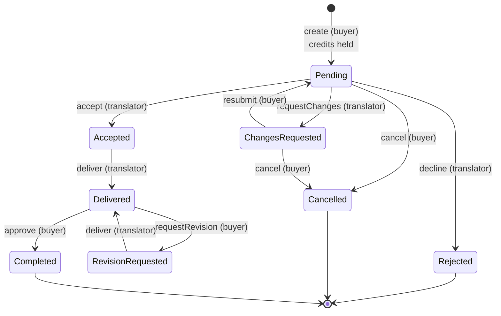

# Translation Marketplace

A backend for a translation marketplace built with **SAP Cloud Application Programming Model (CAP) on Node.js**.
Buyers order translations from translators and pay with credits. Credits are held in escrow when an order is placed and are released to the translator only after the buyer approves the delivered work.

The goal of the project is real business logic rather than CRUD: an order state machine, money handled as a ledger, role-based and record-level authorization, and correctness under concurrent requests.

> **Status:** work in progress. Order lifecycle, pricing, credit hold and authorization are implemented. Refunds and payouts, integration tests and deployment to SAP BTP Cloud Foundry are next. See [Roadmap](#roadmap).

---

## Tech stack

| Area | Technology |
|---|---|
| Runtime | Node.js, ES modules |
| Framework | SAP CAP (`@sap/cds` 10) |
| API | OData V4 |
| Database | SQLite (local, in-memory) → SAP HANA Cloud / PostgreSQL (BTP) |
| Auth | Mocked users locally → XSUAA on BTP |
| Tests | `node:test` (unit), `cds.test` (integration, planned) |

---

## Domain model

`db/schema.cds`, namespace `marketplace`

| Entity | Purpose |
|---|---|
| `Users` | Buyers, translators, admins. Holds `creditBalance` (buyer) and `cashBalance` (translator) |
| `LanguagePairs` | A translator's language pair (e.g. en → bg), approved by an admin |
| `Offers` | Service on a language pair: Translation / Proofreading / Certified, price per word |
| `Orders` | A buyer's order. Prices are calculated and frozen at creation |
| `OrderEvents` | Audit trail: every status change with actor and comment |
| `Transactions` | Ledger: every money movement (TopUp, Hold, Refund, Release, Commission, Withdrawal) |
| `Withdrawals` | A translator's payout request, approved by an admin |

---

## Order lifecycle



- The status changes **only through bound actions** (`POST /Orders(<id>)/accept`, ...), never through `UPDATE`.
- All transitions are defined in one table, [`srv/lib/order-workflow.js`](srv/lib/order-workflow.js), which is unit-tested.
- Every transition writes an `OrderEvents` record (from, to, actor, comment).

---

## Key design decisions

### Money as a ledger
Balances are never edited directly. Every movement is a row in `Transactions`, and the balance is updated in the **same database transaction**.
The invariant is that **a user's balance always equals the sum of their transactions** and never becomes negative.

### Correct under concurrency
Read-check-write in application code is a race condition. Checks and writes are combined into one atomic statement instead:

```js
// Hold credits: succeeds only if the balance is sufficient at write time
const held = await UPDATE("marketplace.Users")
  .with({ creditBalance: { "-=": price } })
  .where({ ID: userId, creditBalance: { ">=": price } });
if (held !== 1) return req.reject(400, "Insufficient credits");
```

Status transitions use the same idea (optimistic concurrency): `UPDATE ... WHERE ID = ? AND status = <status read>`.
Verified manually: three parallel orders against a balance that covers only one give `201, 400, 400`, and two parallel approvals of the same order give `200, 409`. Automated concurrency tests are planned with `cds.test`.

### Pricing
```
translatorPrice = round2(pricePerWord × wordCount)
commission      = max(translatorPrice × rate, minimum)
buyerPrice      = translatorPrice + commission
```
- Implemented as a pure function ([`srv/lib/pricing.js`](srv/lib/pricing.js)) in **integer cents**, because JavaScript floating point is not exact (`0.07 * 3 = 0.21000000000000002`).
- `Decimal` in the database, never `Double`.
- The commission rate and minimum are configuration (`cds.env.marketplace.commission`), not code.
- Prices are copied into the order at creation, so later offer changes do not affect existing orders.

### Authorization
- Three services, one per role: `BuyerService`, `TranslatorService`, `AdminService` (`@requires`).
- Record-level access with `@restrict` + `where` (e.g. a buyer only sees their own orders).
- **Projections list fields explicitly**: buyers never see `translatorPrice` or `commission`, translators never see `buyerPrice` or the buyer.
- Fields the client must not set (`status`, owner, prices) are `@readonly` or ignored. Order creation writes an explicit field list, which prevents mass assignment.
- Ownership on create and immutable fields on update are checked in handlers, because `@restrict.where` filters existing rows only.

### Validation
- Rules about a single value are declarative (`@mandatory`, `@assert.range`), on entities and on action parameters.
- Rules that need other data (offer availability, available balance) are in handlers.

---

## Project structure

```
db/
  schema.cds              domain model
  data/*.csv              seed data
srv/
  buyer-service.cds/.js   catalog, quote, top-up, orders, buyer transitions
  translator-service.cds/.js  language pairs, offers, translator transitions, withdrawals
  admin-service.cds       admin view
  lib/
    pricing.js            pure pricing function
    order-workflow.js     state machine table
    order-transition.js   executes a transition (ownership, optimistic lock, audit event)
test/
  *.test.js               unit tests (node:test)
  requests.http           manual requests (VS Code REST Client)
```

---

## Getting started

Requirements: Node.js 22+, `@sap/cds-dk` (`npm i -g @sap/cds-dk`).

```bash
npm install
cds watch          # http://localhost:4004, in-memory SQLite with seed data
npm test           # unit tests
```

### Test users (mocked auth, password `pass`)

| User | Role |
|---|---|
| `buyer1`, `buyer2` | Buyer |
| `translator1`, `translator2` | Translator |
| `admin` | Admin |

### Try it

All requests are in [`test/requests.http`](test/requests.http). A short flow:

```http
### 1. Buyer: catalog
GET http://localhost:4004/odata/v4/buyer/Offers
Authorization: Basic buyer1:pass

### 2. Buyer: price preview
GET http://localhost:4004/odata/v4/buyer/quote(offer=aaaaaaaa-0000-0000-0000-000000000001,wordCount=1000)
Authorization: Basic buyer1:pass

### 3. Buyer: top up and order
POST http://localhost:4004/odata/v4/buyer/topUp
Authorization: Basic buyer1:pass
Content-Type: application/json

{ "amount": 100 }

### 4. Buyer: create order (96 credits are held)
POST http://localhost:4004/odata/v4/buyer/Orders
Authorization: Basic buyer1:pass
Content-Type: application/json

{ "offer_ID": "aaaaaaaa-0000-0000-0000-000000000001", "wordCount": 1000, "title": "Contract" }

### 5. Translator: accept
POST http://localhost:4004/odata/v4/translator/Orders(<order-id>)/TranslatorService.accept
Authorization: Basic translator1:pass
Content-Type: application/json

{}
```

---

## How this project is built

I am building this project as a hands-on way to learn SAP CAP, working with [Claude Code](https://claude.com/claude-code) as an AI pair programmer.
I make the design decisions and review every change. The goal is to understand and be able to explain every line in the repository.
The working agreement, domain decisions and lessons learned are in [`CLAUDE.md`](CLAUDE.md) (in Bulgarian).

---

## Roadmap

- [x] Domain model, enums, seed data, commission configuration
- [x] Role-based services, `@requires` / `@restrict`, mocked auth
- [x] Handlers: validation, pricing, quote, top-up, order creation with credit hold
- [x] Order state machine with bound actions and audit trail
- [ ] Refund on reject / cancel, release + commission on approve, withdrawals; atomicity
- [ ] Integration tests with `cds.test`: full flow, refund, insufficient balance, double approval, ledger invariant
- [ ] Custom Express middleware / REST endpoint, Dockerfile
- [ ] Deployment to SAP BTP Cloud Foundry (MTA, XSUAA, HANA Cloud / PostgreSQL)
- [ ] Fiori Elements admin UI
